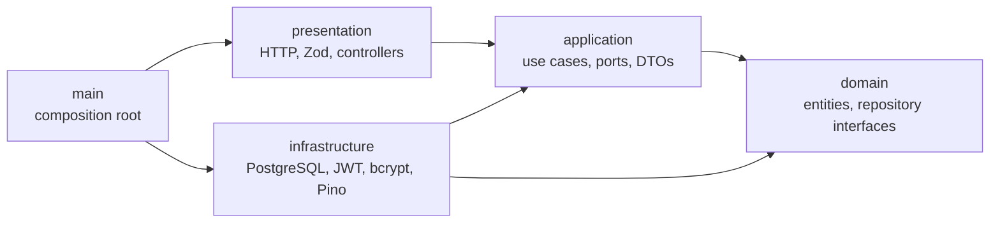

# Entrega Certa API

REST API that runs the day-to-day operation of a non-profit that distributes food baskets to families: beneficiary admission and waiting list, monthly distributions, check-in and pickup, inventory, basket assembly and full audit trail.

Built with **Node.js, TypeScript and PostgreSQL**, following **Clean Architecture** with role-based access control and an integration suite that runs against a real, isolated database.

> 🇧🇷 Documentação em português: [docs/README.pt-BR.md](docs/README.pt-BR.md) e a pasta [`docs/`](docs).

**Live demo:** [pastoral-fronted-ashy.vercel.app](https://pastoral-fronted-ashy.vercel.app) · read-only account `demo` / `senhaTeste`
**Frontend:** [gabrielmdss/pastoral_fronted](https://github.com/gabrielmdss/pastoral_fronted)
**API docs:** `GET /docs` (Swagger UI) and `GET /openapi.json`

> The demo runs on Render's free tier, so the first request may take up to a minute while the service wakes up.

## Highlights

- **85 endpoints** across 16 business modules: beneficiaries, waiting list, capacity, monthly entitlements, distributions, check-in, pickups and reversals, extra baskets, absence justifications, inventory, basket models, planning, assembly, dashboard, reports and audit.
- **Clean Architecture**: domain and use cases have no dependency on Express, PostgreSQL or JWT. Infrastructure implements ports; a single composition root wires everything.
- **Security**: JWT authentication, **RBAC with 34 permissions** reloaded from the database on every request (no stale permissions in tokens), bcrypt password hashing, Helmet, CORS allow-list and Zod validation on every input.
- **Transactional consistency**: explicit `BEGIN/COMMIT/ROLLBACK` with row locks for capacity and inventory, idempotent entitlement generation and database constraints as the last line of defense.
- **Observability**: structured logs with Pino, request correlation IDs, `/health` and `/ready` probes and an admin status endpoint.
- **~150 automated tests** with Vitest and Supertest, including an integration suite that creates a throwaway PostgreSQL database per run and verifies concurrency with real locks (e.g. a duplicate pickup must result in exactly `201 + 409`).

## Architecture



| Layer | Responsibility |
|---|---|
| `domain` | Entities and persistence interfaces. No framework code. |
| `application` | Use cases, DTOs and ports. Depends only on the domain and its own abstractions. |
| `infrastructure` | PostgreSQL repositories, JWT, bcrypt, file storage and logging. |
| `presentation` | Express routes and controllers, Zod validation, error translation. |
| `main` | Validates configuration, builds dependencies, registers routes and manages the process. |

A request flows like this: `route → controller → use case → repository port → PostgreSQL adapter`. Read-heavy features (dashboard, reports, history) follow a pragmatic CQRS approach with dedicated query ports.

More detail in [docs/architecture.md](docs/architecture.md), [docs/business-rules.md](docs/business-rules.md) and [docs/route-access-matrix.md](docs/route-access-matrix.md).

## Tech stack

| Area | Tools |
|---|---|
| Runtime | Node.js, TypeScript, Express 5 |
| Database | PostgreSQL (`pg`, parameterized SQL, migrations) |
| Auth | JSON Web Tokens, bcrypt, permission-based RBAC |
| Validation & security | Zod, Helmet, CORS |
| Logging | Pino, pino-http |
| Docs | OpenAPI + Swagger UI, Postman collection |
| Quality | Vitest, Supertest, ESLint, Prettier, `tsc --noEmit` |

## Getting started

Requirements: Node.js LTS and PostgreSQL 17+ with the `pgcrypto` and `pg_trgm` extensions.

```bash
npm install
cp .env.example .env        # fill in your database credentials and a JWT secret (32+ chars)
npm run database:setup      # create the database and apply the migrations
npm run users:seed          # create permissions, roles and one user per role
npm run database:seed-demo  # optional: load fictional demo data
npm run dev
```

The API starts on `PORT` (see `.env.example`). Startup fails fast if any required environment variable is missing or invalid.

### Useful scripts

| Script | What it does |
|---|---|
| `npm run dev` | Start in watch mode |
| `npm run build` / `npm start` | Compile and run the production build |
| `npm test` | Unit and integration tests |
| `npm run test:integration` | Integration suite only (needs a PostgreSQL user that can create databases) |
| `npm run typecheck` / `npm run lint` | Static checks |
| `npm run users:seed-demo` | Create the read-only public demo account |
| `npm run database:clear-demo` | Remove demo data |

## Authentication

```http
POST /api/v1/auth/login
Content-Type: application/json

{ "login": "demo", "senha": "senhaTeste" }
```

Send the returned token as `Authorization: Bearer <token>`. The JWT carries only the user ID; roles and permissions are loaded from the database on every request, so revoking a permission takes effect immediately.

The public `demo` account has view-only permissions and cannot change its password.

## Project structure

```text
src/
├── domain/           # entities and repository interfaces
├── application/      # use cases and ports, one folder per business module
├── infrastructure/   # PostgreSQL adapters, JWT, bcrypt, storage, logging
├── presentation/     # Express routes, controllers, Zod schemas, middlewares
├── main/             # config validation, dependency wiring, server
└── shared/           # cross-cutting errors and helpers
tests/
├── unit/             # use cases, middlewares and adapters
└── integration/      # real HTTP + real PostgreSQL in an isolated database
docs/                 # architecture, business rules, API, testing, observability
database/migrations/  # versioned SQL migrations
postman/              # Postman collection and environment
```

## Author

**Gabriel Mendes**, Full Stack Developer · [Portfolio](https://portfolio-wine-nu-30.vercel.app) · [LinkedIn](https://linkedin.com/in/gabrielmendesdeveloper)
